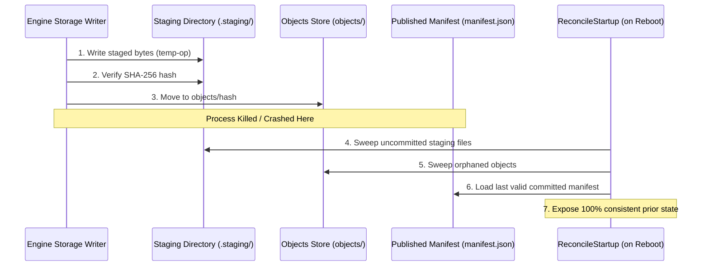

# PolicyHelix: Maintenance & Dependency Policy

> **Document Version:** 1.0.0  
> **Task Reference:** C38  
> **Requirement:** N38  
> **License:** Apache-2.0  
> **Scope:** Toolchain Pins, Dependency Governance, Security Auditing, Crash Recovery, and Upstream Standards

---

## 1. Maintenance Philosophy

PolicyHelix is developed and maintained under the [Apache-2.0](file:///home/amirreza/Desktop/Projects/Policyhelix/LICENSE) license. All updates, dependency changes, and architectural refinements prioritize:
- **Reproducibility:** Hermetic, reproducible builds from source (`policyhelix-source.tar.gz`) without hidden build steps.
- **Minimal External Surface:** Minimizing runtime dependencies and prioritizing standard libraries.
- **Fail-Closed Security:** System crashes, disk exhaustion, and unexpected termination must fail closed without compromising private authorization boundaries.

---

## 2. Toolchain Pins & Dependency Governance

### 2.1 Core Toolchain Pins

| Tool / Runtime | Pinned Version Window | Purpose | Verification Command |
|---|---|---|---|
| **Node.js** | `>= 24.19.0 < 25` | Web workspace, scripts, and build tooling | `node -v` |
| **npm** | `^11.17.0` | Locked package manager | `npm -v` |
| **Go Compiler** | `>= 1.26` | High-performance policy evaluation engine | `go version` |
| **Git** | Standard Git client | Source control and clone-smoke verification | `git --version` |

### 2.2 Dependency Policy:
1. **Locked Package Manifests:** All JavaScript/TypeScript dependencies must be committed in `package-lock.json`. Routine installation must enforce locked trees (`npm run setup` / `npm ci --ignore-scripts`).
2. **Standard Library Preference:** In the Go engine (`cmd/policyhelix` and `internal/`), core capabilities (HTTP routing, JSON serialization, Ed25519 cryptography, SHA-256 hashing, SQLite driver) rely strictly on Go standard libraries and audited open-source drivers.
3. **Allowed Upstream Licenses:** All dependencies and transitive libraries must be licensed under permissive open-source licenses:
   - Apache-2.0
   - MIT
   - BSD-2-Clause / BSD-3-Clause
   - ISC
   - Restrictive copyleft licenses (e.g. AGPL, GPLv3) and proprietary licenses are strictly prohibited.
4. **Software Bill of Materials (SBOM):** Every release package includes a machine-readable CycloneDX 1.5 JSON SBOM (`sbom.json`) cataloging all shipped components and licenses.

---

## 3. Upstream Standards & Dependency Pins

PolicyHelix interoperates with open-source industry standards:

- **Open Policy Agent (OPA):** Pinned to OPA `v1.2.0` Rego rule evaluation semantics. Rules are authored and verified under `rules/policy.rego`.
- **Keycloak & OpenID Connect (OIDC):** Conforms to [OpenID Connect Core 1.0](https://openid.net/specs/openid-connect-core-1_0.html). Tested against Keycloak `26.1.3` token schemas (RS256/Ed25519 signatures, standard claims `sub`, `iss`, `aud`, `exp`, `iat`, `roles`).
- **Cryptographic Signatures:** Bundles and release artifacts are signed using Ed25519 (`ed25519-primary-2026`).

---

## 4. Security Auditing & Vulnerability Disclosure

### 4.1 Automated Auditing Routines
- **Node.js Dependencies:** Checked continuously via `npm audit --audit-level=high`.
- **Go Engine Dependencies:** Audited via `govulncheck ./...`.
- **Repository Invariant Linter:** Validated continuously via `python3 scripts/validate_repo.py` checking all schema and manifest invariants.

### 4.2 Responsible Vulnerability Reporting
Security researchers and operators can report suspected security issues privately:
- **Primary Contact:** `security@policyhelix.org`
- **GitHub Security Advisories:** Submit reports through private GitHub repository advisories.
- **Response Commitment:** Initial acknowledgment within 48 hours; confirmed fixes released via signed patch releases.

---

## 5. Storage Crash Recovery & Invariant Runbook

### 5.1 Writer Crash at Staged-Byte / Manifest Boundary
- **Failure Mode:** Process is killed or loses power while writing payload to `staging/temp-op` or staging `manifest.tmp`.
- **Recovery Invariant:** On subsequent launch, `storage.Open()` executes `ReconcileStartup()`:
  1. Any uncommitted files in `staging/` are removed.
  2. Any unpromoted `manifest.tmp` is deleted.
  3. All records in `manifest.json` are verified against `objects/<hash>` SHA-256 digests.
  4. Only the complete prior authoritative state is exposed. Zero partial writes or state corruption occurs.

### 5.2 Operation Replay & Lost ACK Deduplication
- **Failure Mode:** Network client sends a write request, the engine commits it, but the ACK response is lost in transit. Client replays the request with the same `OperationID`.
- **Recovery Invariant:** The engine checks committed operations in `manifest.json`:
  1. If `OperationID` exists and the payload matches, the stored receipt is returned immediately with `replayed: true` and 0 duplicate side effects.
  2. If `OperationID` is replayed with a mismatched or modified payload, the request is rejected with `ErrOperationConflict`.

### 5.3 Storage Quota & Disk Exhaustion
- **Failure Mode:** System disk fills up or total record count reaches the quota boundary (`MaxTotalRecords = 100000`).
- **Recovery Invariant:**
  1. The storage adapter checks `MaxTotalRecords` before allocating records.
  2. If disk write or `fsync` fails, the write operation is aborted before updating `manifest.json`.
  3. Returns typed error `ErrDiskFullOrWriteFailed`.
  4. The existing published manifest remains fully readable and uncorrupted.

### 5.4 Fail-Closed Security Posture
- Across all storage, network, or provider outages, private resources fail closed (`allow: false`).
- Unauthenticated requests fail closed with `ErrUnauthenticatedIdentity` or HTTP 401/403.
