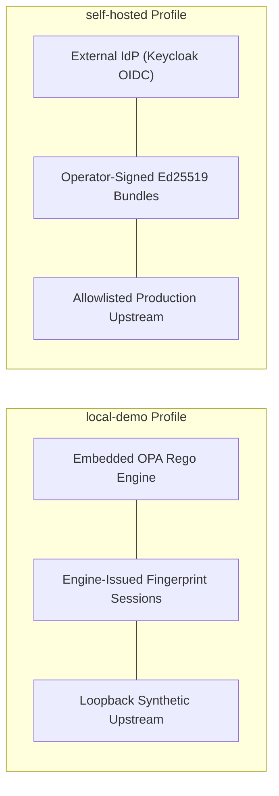

# PolicyHelix: Service Policy & Local Data Governance

> **Document Version:** 1.0.0  
> **Task Reference:** C38  
> **Requirement:** N38  
> **License:** Apache-2.0  
> **Scope:** Local Data Governance, Lifecycle, Storage Layout, Privacy Limits, and Operational Profiles

---

## 1. Zero Hosted Subscription & No Unearned SLA

PolicyHelix is an open-source, local-first policy engine and authorization workspace designed for autonomous local execution.

### Non-Commercial Operational Principles:
1. **Zero Hosted Subscription:** PolicyHelix requires no paid subscriptions, vendor API keys, proprietary cloud platforms, or compulsory SaaS accounts. Every core feature operates fully offline on localhost (`127.0.0.1`, `[::1]`).
2. **No Unearned Service Level Agreements (SLA):** As an open-source software distribution provided under the [Apache-2.0](file:///home/amirreza/Desktop/Projects/Policyhelix/LICENSE) license, PolicyHelix does not promise unearned commercial uptime, cloud availability guarantees, or third-party response times. Availability, redundancy, monitoring, and failover are operator-managed within the infrastructure running the supervisor and engine.
3. **No External Phoning Home:** Zero tracking pixels, commercial telemetry beacons, or external reporting channels are embedded in the software.

---

## 2. Local Data Architecture & Directory Layout

PolicyHelix stores all durable application state locally under the root data directory `.local-data/` (configurable via `--storage-dir`).

```
.local-data/
├── policyhelix.db              # SQLite metadata database (sessions, revocations, epochs, audits)
└── storage/                    # Content-addressed authoritative storage adapter
    ├── manifest.json           # Atomic published state manifest (monotonic revision, operations)
    ├── manifest.tmp            # Ephemeral staging file during atomic manifest updates
    ├── objects/                # Immutable content-addressed records (<sha256>)
    │   ├── 4a5c88e5d...        # Stored policy bundles, rules, or classified payloads
    │   └── 9b41b88d2...
    └── staging/                # In-flight write-ahead staging files
        └── temp-op-123         # Cleaned up automatically on engine startup if uncommitted
```

### Component Details:

| Path | File Format | Lifecycle & Mutability | Invariants Enforced |
|---|---|---|---|
| `.local-data/storage/manifest.json` | JSON (schema v1) | Updated atomically via `rename()` | Monotonic revision counter, operations log, active record digest index. |
| `.local-data/storage/objects/<hash>` | Serialized JSON bytes | Immutable content-addressed objects | Pinned SHA-256 digest integrity check on every read. |
| `.local-data/storage/staging/` | Temporary file bytes | Ephemeral; swept on startup | Uncommitted staging files are discarded on restart by `ReconcileStartup()`. |
| `.local-data/policyhelix.db` | SQLite 3 database | Transactional ACID updates | Monotonic session revocation epochs, ring-buffered audit logs, session records. |

---

## 3. Data Lifecycle, Retention & Deletion Policies

### 3.1 Policy Bundles & Monotonic Revisions
- **Retention:** The active policy bundle revision and historical content-addressed objects are retained durably in `.local-data/storage/`.
- **Monotonic Revision Floors:** The engine enforces strict monotonicity. Expired, downgraded, or stale bundle candidates (revision <= active revision) are rejected during activation.
- **Rollback Gap Prevention:** In recovery scenarios, an older backup cannot overwrite a higher accepted revision. Replaying an older operation ID with mismatched bytes is rejected with `OPERATION_ID_CONFLICT`.

### 3.2 Session Persistence & Revocation Epochs
- **Session Duration:** Local sessions carry a configurable expiration TTL (default: 3600 seconds).
- **Bounded Revocation:** Incrementing a user or global revocation epoch marks affected sessions revoked immediately. The gateway enforces revocation within a strict 30-second upper bound.
- **Revocation Storage:** Revoked session identifiers are persisted in SQLite; revoked sessions remain denied across engine and supervisor process restarts.

### 3.3 Audit Logs & Sensitive Credential Redaction
- **Scrubbing:** Decision audit logs capture `subject_id`, `resource`, `action`, `decision`, and `reasons`. All bearer tokens, session secrets, `Cookie` headers, and passwords are unconditionally stripped and replaced with `[REDACTED]`.
- **Ring-Buffer Retention:** In-memory diagnostics maintain a bounded ring buffer (default: 500 entries) preventing unbounded memory growth.

### 3.4 Data Export & Deletion Procedures
- **Data Export:** Operators can export the full reference workflow state or decision history as standard JSON (`schema_version: 2`) via the browser workspace export control or by copying `.local-data/storage/manifest.json`.
- **Complete Deletion (Right to be Forgotten):** Stopping the supervisor and removing `.local-data/` permanently purges all local records, bundles, sessions, and databases with zero residual cloud state.

---

## 4. Backup & Disaster Recovery Runbook

### 4.1 Hot Backup Strategy
Operators should periodically back up the `.local-data/` directory using standard filesystem tools:
```bash
# 1. Quiesce or ensure clean read
sqlite3 .local-data/policyhelix.db ".backup '.local-data/backup-policyhelix.db'"

# 2. Archive storage objects and manifest
tar -czf policyhelix-backup-$(date +%F).tar.gz \
    .local-data/storage/manifest.json \
    .local-data/storage/objects/ \
    .local-data/backup-policyhelix.db
```

### 4.2 Disaster Recovery & Forward Repair
- **Safe Recovery:** Restoring from a backup restores committed objects and the manifest.
- **Forward Repair Rule:** If state divergence occurs, operators must publish a new higher monotonic revision (forward repair) rather than restoring an obsolete backup over newer accepted records.

---

## 5. Supported Operational Profiles

PolicyHelix formally defines and supports two runtime operational profiles:



| Dimension | `local-demo` Profile | `self-hosted` Production Profile |
|---|---|---|
| **Intended Use** | Development, testing, automated CI, and evaluation. | Single-tenant, self-hosted corporate deployments. |
| **Identity Provider** | Engine-issued, fingerprint-bound revocable sessions. Zero external dependencies. | Self-hosted Keycloak or standard OpenID Connect (OIDC) identity provider. |
| **Policy Engine** | Embedded Open Policy Agent (OPA v1.2.0) evaluator. | Embedded OPA with operator-controlled trust key rotation (Ed25519). |
| **Upstream Protection** | Loopback synthetic analytics demo upstream (`service:analytics`). | Single allowlisted HTTP/HTTPS upstream reverse proxy with origin isolation. |
| **Network Profile** | Loopback binding only (`127.0.0.1:4173`, `127.0.0.1:4174`). | Loopback binding behind operator-managed private TLS reverse proxy. |
| **Commercial Requirements** | **Zero.** No accounts, no subscriptions, no cloud tokens. | **Zero.** Completely open source under Apache-2.0. |

---

## 6. Summary

PolicyHelix provides a self-contained, sovereign authorization architecture. All data remains local, all policies are verifiable via cryptographic digests, and all recovery operations adhere to strict fail-closed security.
