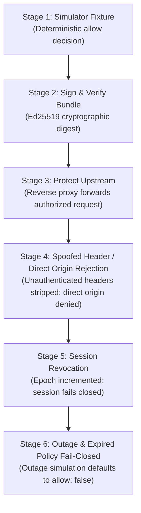

# PolicyHelix: User Guide

Welcome to PolicyHelix. This guide enables a fresh reader to install, build from source, run, test, and maintain the PolicyHelix authorization engine and browser workspace entirely from public instructions.

PolicyHelix is an open-source, local-first policy engine and authorization workflow workspace released under the [Apache-2.0](file:///home/amirreza/Desktop/Projects/Policyhelix/LICENSE) license. No paid accounts, compulsory cloud services, proprietary subscriptions, or external network connectivity are required.

---

## 1. Prerequisites & System Requirements

PolicyHelix requires standard, open-source development toolchains available on standard distributions:

- **Operating System:** Linux x86_64 (officially observed & verified platform baseline; macOS and Linux via WSL2 are supported for development).
- **Node.js:** Node `>= 24.19.0 < 25` (npm bundled with Node 24).
- **Go Toolchain:** Go `>= 1.26`.
- **Git:** Standard git client for repository checkout.
- **Hardware Profile:**
  - CPU: 2 vCPU minimum.
  - RAM: 4096 MiB (4 GB) RAM.
  - Storage: 10240 MiB (10 GB) free disk space.

---

## 2. Quickstart: Clone, Setup, and Run

Execute the following sequence in your terminal to clone and start the local workspace:

```bash
# 1. Clone the public repository
git clone https://github.com/Parsa-Emami/Policyhelix.git
cd Policyhelix

# 2. Run the automated setup and bootstrap
npm run setup

# 3. Start the local supervised workspace
npm start
```

### What Happens During `npm run setup`?
- **Toolchain verification:** Checks that Node and Go match supported versions.
- **Dependency installation:** Installs locked dependencies from `package-lock.json` with lifecycle scripts disabled (`--ignore-scripts`) for security.
- **Engine compilation:** Compiles the Go engine binary into `dist/engine/policyhelix` from local Go source (`./cmd/policyhelix`).
- **Web compilation:** Prepares web static data and builds the React web workspace into `dist/web/`.

### What Happens During `npm start`?
- Starts the PolicyHelix process supervisor on loopback: `http://127.0.0.1:4173` (also listening on `[::1]:4173`).
- Launches the compiled Go engine on internal loopback port `http://127.0.0.1:4174`.
- Mounts durable local storage under `.local-data/` (SQLite database and local JSON state).
- Initializes the owned synthetic demo upstream and local OIDC session provider.
- No second terminal, external database server, cloud token, or public domain is needed.

Open your browser to:
👉 **[http://127.0.0.1:4173](http://127.0.0.1:4173)**

---

## 3. Core Task Walkthrough: The 6-Stage Reference Workflow

Navigate to **Reference Workflow** in the web workspace header. PolicyHelix demonstrates a complete end-to-end authorization lifecycle across 6 sequential stages:



1. **Stage 1 — Simulator Fixture:**
   - Evaluates a deterministic policy input (`tests/fixtures/policyhelix/C01/positive-decision.json`) against the Rego rule engine.
   - Asserts unambiguous decision structure (`allow: true`, `reasons: ["policy_allow_role_operator"]`).
2. **Stage 2 — Sign & Verify Bundle:**
   - Cryptographically signs the policy bundle using Ed25519 private key.
   - Evaluates cryptographic digest, bundle monotonic revision, and timestamped freshness window.
3. **Stage 3 — Protect Owned Upstream:**
   - Issues an authenticated request via the gateway reverse proxy to the private upstream (`service:analytics`).
   - Asserts successful authorized access and proxy delivery.
4. **Stage 4 — Spoofed Header / Direct Origin Rejection:**
   - Sends requests with untrusted spoofed identity headers (`X-Remote-User`, `X-Forwarded-User`) and requests attempting direct origin bypass.
   - Gateway strips unauthenticated headers and rejects direct origin access with `allow: false` / `403`.
5. **Stage 5 — Session Revocation:**
   - Advances revocation epoch for user session.
   - Subsequent requests fail closed within the documented 30-second propagation bound.
6. **Stage 6 — Outage & Expired Policy Fail-Closed:**
   - Simulates policy engine outage and expired policy bundle.
   - Proves fail-closed fallback: engine defaults safely to `allow: false` and emits redacted audit telemetry.

### Alternate Views and Accessibility:
- **Card View vs Table Equivalent:** Use the view toggle to switch between responsive visual cards and a fully accessible semantic HTML table (`role="table"`, header scopes, accessible caption).
- **Sequential Keyboard Navigation:** The workflow supports complete sequential Tab/Shift+Tab navigation and Enter/Space activation.
- **Report Export & Import:** Export workflow verification results as JSON (`schema_version: 2`) or import prior runs (including N-1 backward compatibility). Tampered data fails closed.

---

## 4. Independent Source Builds

PolicyHelix can be compiled and packaged entirely from source without pre-compiled binaries:

```bash
# 1. Compile Go engine binary
npm run build:engine
# Compiles ./cmd/policyhelix -> dist/engine/policyhelix

# 2. Compile web workspace
npm run build
# Runs prepare:web, typecheck, and vite build -> dist/web/

# 3. Create independent source distribution archive
npm run package:source
# Creates self-contained archive at dist/release/policyhelix-source.tar.gz

# 4. Create complete distributable package with SBOM and checksums
npm run package
# Packages engine, web assets, licenses, SBOM (dist/release/sbom.json), and SHA256SUMS.txt
```

All build targets run completely offline once npm and Go modules are cached.

---

## 5. Licenses & Upstream Attribution

PolicyHelix and its original source code are licensed under the **[Apache-2.0 License](file:///home/amirreza/Desktop/Projects/Policyhelix/LICENSE)**.

Upstream dependencies retain their own permissive open-source licenses:
- **Open Policy Agent (OPA):** Apache-2.0 (`github.com/open-policy-agent/opa`)
- **Go SQLite Driver:** MIT (`github.com/mattn/go-sqlite3`)
- **React & React-DOM:** MIT
- **Vite:** MIT
- **TypeScript:** Apache-2.0
- **Playwright:** Apache-2.0

For complete attribution, copyrights, and third-party notices, see **[THIRD_PARTY_NOTICES.md](file:///home/amirreza/Desktop/Projects/Policyhelix/THIRD_PARTY_NOTICES.md)**.
PolicyHelix contains zero proprietary dependencies, paid modules, or dual-license commercial locks.

---

## 6. Data Storage & Layout

PolicyHelix stores all persistent runtime data locally in the repository root under:
```
.local-data/
├── store.db            # SQLite database for sessions, revocation epochs, and bundle metadata
├── audit.log           # Redacted operational audit telemetry (tokens/secrets masked)
└── bundles/            # Signed policy bundle cache and public key definitions
```

- **Persistence:** Local SQLite database with WAL journaling ensures durability across process restarts.
- **Data Isolation:** All data stays on the local filesystem. No data is synchronized with external servers or remote telemetry sinks.
- **Portability:** The `.local-data/` directory can be backed up or inspected using standard tools (`sqlite3`).

---

## 7. Operational Limits & Resource Boundaries

- **Decision Latency Deadline:** Engine evaluation completes within `<= 200 ms` per decision request.
- **Revocation Propagation Bound:** Session revocation takes effect across all gateway endpoints within `<= 30 s`.
- **Hardware Profile:** Baseline execution tested on 2 vCPU, 4096 MiB RAM, 10240 MiB free disk.
- **Network Boundaries:**
  - Loopback host binding: Strictly `127.0.0.1` and `::1`.
  - Host validation: Rejects non-loopback `Host` headers (`403 {"error":"invalid_host"}`).
  - Origin isolation: Rejects untrusted cross-origin requests (`403 {"error":"invalid_origin"}`).
  - Cache control: `Cache-Control: no-store` on all dynamic and API endpoints.

---

## 8. Privacy & Telemetry

- **Zero Phoning Home:** PolicyHelix transmits zero analytics, telemetry, or user usage payloads to external servers.
- **Loopback Enforced:** All network sockets bind exclusively to loopback interfaces.
- **Header Sanitization:** Ingress proxy automatically strips unauthenticated identity headers (`X-Remote-User`, `X-Forwarded-User`) to prevent identity injection.
- **Redacted Logging:** Audit logs strictly redact tokens, credentials, and sensitive payload attributes before writing to disk.

---

## 9. Crash Recovery & Forward Repair

PolicyHelix employs crash-resilient storage practices:
- **Atomic File Operations:** Writes to configuration and bundle artifacts use staged writers and atomic renames to prevent partial corruption.
- **Supervisor Restarts:** The process supervisor safely recovers state from `.local-data/store.db` upon restart without losing revocation epochs or accepted bundle versions.
- **Forward Repair Principle:** Never overwrite newer accepted state with an older backup. If corruption occurs, restore valid data forward and replay uncommitted events.

---

## 10. Community Support & Issue Reporting

PolicyHelix is maintained by the open-source community:
- **Bug Reports & Feature Requests:** Open an issue on GitHub: [GitHub Issues](https://github.com/Parsa-Emami/Policyhelix/issues).
- **Discussions & Questions:** Join the community discussion on GitHub: [GitHub Discussions](https://github.com/Parsa-Emami/Policyhelix/discussions).
- **Contributing:** Read **[CONTRIBUTING.md](file:///home/amirreza/Desktop/Projects/Policyhelix/CONTRIBUTING.md)** for developer instructions, code standards, and DCO sign-off requirements.

---

## 11. Security & Vulnerability Reporting

Security vulnerabilities should **never** be reported via public GitHub issues.

PolicyHelix maintains a confirmed private vulnerability reporting route:
- **GitHub Private Vulnerability Reporting:** Navigate to the repository's **Security** tab and click **Report a vulnerability**.
- **Security Email:** Contact `security@policyhelix.org` for confidential coordination.
- Full details, response SLAs, and coordinated disclosure policies are documented in **[SECURITY.md](file:///home/amirreza/Desktop/Projects/Policyhelix/SECURITY.md)**.
